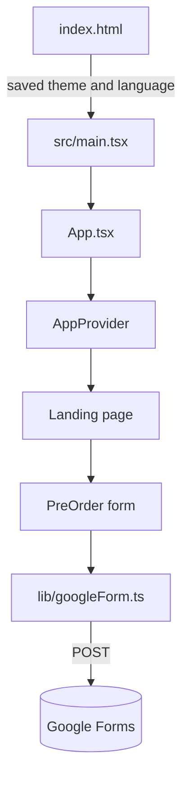

# dibrah / دِبــرة

Bilingual (English / Arabic) landing page for **dibrah**, a product of **Approved Technology Models LLC**. Static React app: no backend. The pre-order form posts from the browser to a Google Form.

Live on GitHub Pages at `/dibrah/`, deployed from `main`.

**Stack:** React 19, TypeScript, Vite 8, Tailwind 4, Oxlint. Runtime deps are `react` and `react-dom` only.

## Run locally

Node 22+ and npm.

```bash
npm ci
npm run dev      # http://127.0.0.1:5173/  (served from /, not /dibrah/)
npm run build    # type-check + production build to dist/ with base /dibrah/
npm run preview  # http://127.0.0.1:4173/dibrah/
npm run lint
```

## How it fits together



- Copy lives in `src/i18n/content.ts` (keep English and Arabic keys in sync).
- Language and theme are stored in `localStorage` (`dibrah-lang`, `dibrah-theme`).
- Design tokens are in `src/index.css`. Components use Tailwind plus `useApp().t` for text.
- Google Form IDs and option strings are in `src/lib/googleForm.ts`. If the form is recreated, update those constants so they still match.

## Deploy

Push to `main`. `.github/workflows/deploy.yml` runs `npm ci` and `npm run build`, then publishes `dist/` to GitHub Pages.

The production `base` is `/dibrah/`. `public/404.html` plus a small script in `index.html` restore deep links after a refresh.

## Troubleshooting

- Blank page or missing `/dibrah/assets/...`: serve the build from `/dibrah/`, or change `base` in `vite.config.ts`.
- Port 5173 in use: Vite prints the next free port.
- Form rows missing in Google Forms: confirm the form still accepts responses and that `src/lib/googleForm.ts` still matches the form fields and choices.
